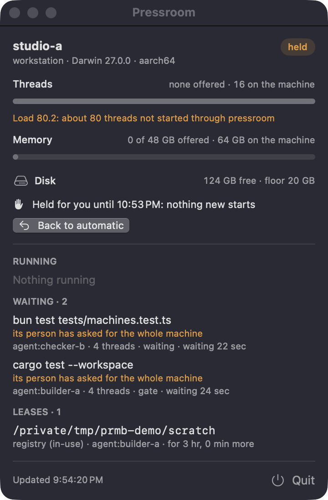
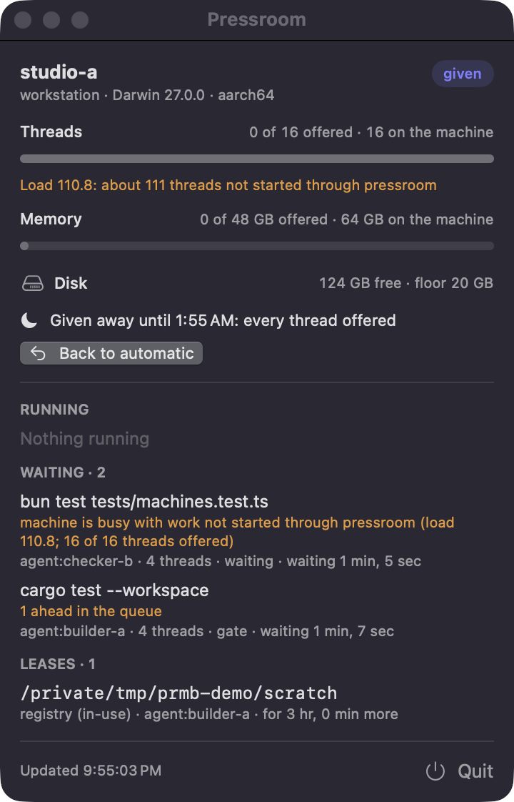

# Pressroom in the menu bar

A small macOS menu bar item for the Pressroom daemon on this Mac. It shows:

- whether the daemon is running;
- threads and memory in use against what the machine offers, and load not started
  through pressroom;
- whether the machine thinks its person is present;
- what is running, what waits and why;
- free disk against the floor;
- live leases.

It also lets the person say **Hold the machine** ("I need the whole machine": nothing new
starts) or **Take it all** ("I am away": every thread is offered), for a set time, and
**Back to automatic**. Those are the person's rules, 19 to 21 of
[`contracts/local-v1.md`](../../contracts/local-v1.md).

It is only a client. It talks to the daemon over its socket (`$PRESSROOM_HOME/sock`, else
`~/.pressroom/sock`) with the `status` and `person-says` ops, every three seconds. It never
starts, admits, leases or cleans anything, and with no daemon it says so and does nothing.

 

## Start at login

On by default, applied once, the first time the app runs from `/Applications` or
`~/Applications`. Turn it off with the checkbox in the panel. A copy run from a build
folder is never registered.

## Build

Swift 6 language mode, macOS 15 or later, no dependencies. Start builds through pressroom:

```sh
pressroom run --threads 4 --memory-gb 4 --lane pressroom-menubar -- swift test
pressroom run --threads 4 --memory-gb 4 --lane pressroom-menubar -- scripts/bundle.sh
```

`scripts/bundle.sh` writes `build/Pressroom.app`, signed ad hoc. Copy it to
`~/Applications` to keep it.

`PressroomKit` holds the socket client and the status decoding; its tests use a fake
daemon on a scratch socket and synthetic fixtures.

`Pressroom.app/Contents/MacOS/PressroomMenuBar --window` opens the same panel in an
ordinary window, for a menu bar that is hidden or full, and prints the window number so
`screencapture -l` can take a picture of the panel alone.
